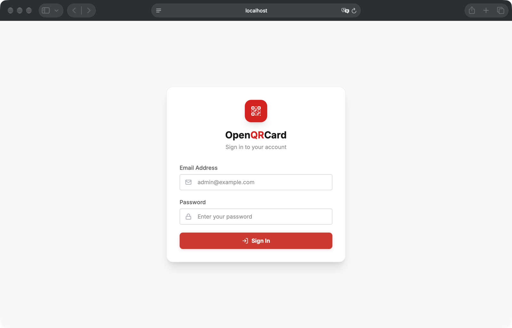
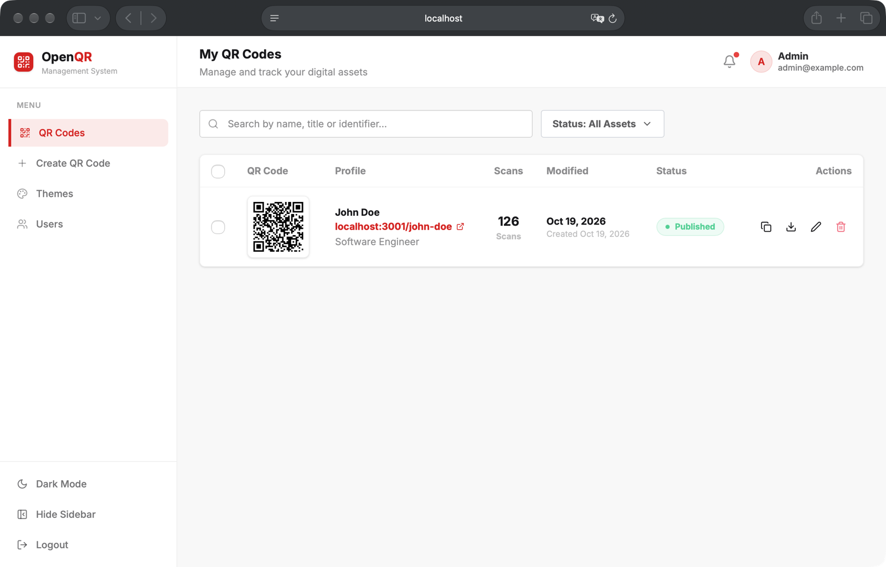
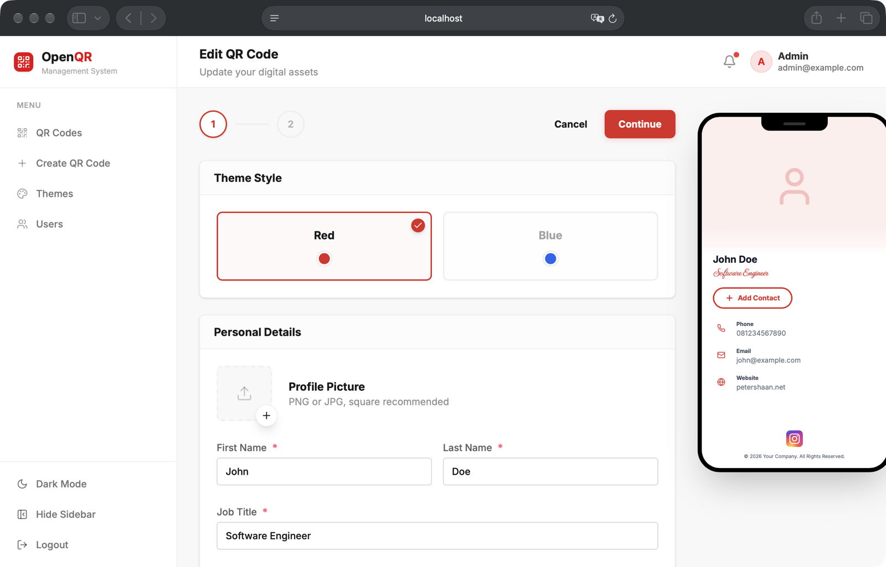
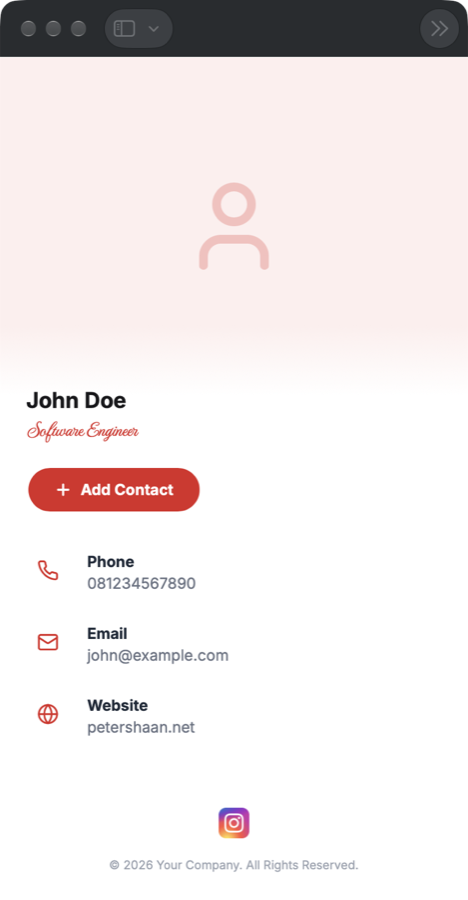

<p align="center">
  <h1 align="center">OpenQRCard</h1>
  <p align="center">
    Made with ❤️ by <a href="https://github.com/petershaan12">Peter Shaan</a>.
  </p>
</p>

<p align="center">
  OpenQRCard – an open-source, self-hosted digital business card & QR code manager.
</p>

<p align="center">
  <a href="https://reactrouter.com/">
    
  </a>
  <a href="https://tailwindcss.com/">
    
  </a>
  <a href="https://www.mysql.com/">
    
  </a>
  <a href="https://www.docker.com/">
    
  </a>
  <a href="https://github.com/petershaan12/qr-code/blob/main/LICENSE">
    
  </a>
</p>

## About

OpenQRCard lets you create digital business cards that open from a QR code. Each person gets a public profile page (`/your-id`) with their name, title, phone numbers, emails, social links and a **Save to Contacts** button that downloads a vCard.

Built with **React Router v7 (SSR)**, **React 19**, **TailwindCSS 4**, **DaisyUI** and **MySQL**. Ships with Docker Compose so you can self-host it on any server in minutes.

Great for companies, teams, events, or anyone who wants their own Linktree-style contact card without paying for a SaaS.

---

## Features

- **QR Code Generation**: Every card gets a QR code (via `qrcode.react`) ready to print or share.
- **Public Profile Card**: Mobile-friendly card page at `/:id` — no login needed for visitors.
- **vCard Download**: One tap "Save to Contacts" (`/:id/vcard`).
- **Live Phone Preview**: See changes in a phone mockup while editing.
- **Multiple Contacts**: Add multiple phone numbers, emails and social links (Instagram, LinkedIn, WhatsApp, TikTok, YouTube, etc.).
- **Theme System**: Create brand themes with primary color and legal/footer text, then apply them per card.
- **User Management**: Admin dashboard to manage users and roles.
- **Scan Counter**: Track how many times each card was opened.
- **Draft / Published**: Keep cards private until ready.
- **Docker Ready**: `docker compose up` and you're live.

---

## How to Use

1. **Clone the repository**:

   ```bash
   git clone https://github.com/petershaan12/qr-code.git
   cd qr-code
   npm install
   ```

2. **Set up environment variables**: copy `.env.example` to `.env` and fill in your own values.

   ```bash
   cp .env.example .env
   ```

   | Variable | Description |
   | --- | --- |
   | `MYSQL_ROOT_PASSWORD` | MySQL root password (used by the app too) |
   | `MYSQL_DATABASE` | Database name |
   | `SESSION_SECRET` | Random string for signing session cookies (`openssl rand -hex 32`) |
   | `MYSQL_PORT` | MySQL port exposed on host |
   | `APP_PORT` | App port inside the container |
   | `APP_PUBLIC_PORT` | App port exposed on host |

   When running without Docker, the app reads `DB_HOST`, `DB_PORT`, `DB_USER`, `DB_PASSWORD`, `DB_NAME` and `SESSION_SECRET`.

3. **Create the database**: import the schema (and optional seed data) from `database/init.sql`.

   ```bash
   mysql --default-character-set=utf8mb4 -u root -p your_database < database/init.sql
   ```

4. **Run the project**:

   ```bash
   npm run dev
   ```

   Open [http://localhost:5173](http://localhost:5173) and log in with the seeded admin account: **`admin@example.com` / `password`**. Change the email and password right away after first login.

5. **Deploy with Docker**:

   ```bash
   docker compose up -d --build
   docker exec -i qrcard_mysql sh -c 'mysql --default-character-set=utf8mb4 -uroot -p"$MYSQL_ROOT_PASSWORD" "$MYSQL_DATABASE"' < database/init.sql
   ```

   The app is now running on `http://localhost:3001` (or your `APP_PUBLIC_PORT`). Put it behind Nginx with HTTPS for production — see [DEPLOYMENT.md](DEPLOYMENT.md) for a full guide.

## Screenshots

| Login | Dashboard |
| --- | --- |
|  |  |
| **Card Editor + Live Preview** | **Public Card** |
|  |  |

## No Docker? Use the `php` branch (Shared Hosting / cPanel)

Don't have a VPS or Docker? The [`php`](https://github.com/petershaan12/qr-code/tree/php) branch has the same app as a static **React + Vite** frontend with a **PHP 7.4+** backend, so it runs on cheap shared hosting (cPanel, Hostinger, Niagahoster, etc.) with just Apache + MySQL.

1. **Checkout the branch**:

   ```bash
   git clone -b php https://github.com/petershaan12/qr-code.git qr-code-php
   cd qr-code-php
   npm install
   ```

2. **Run locally** (needs Node.js 20+ and PHP):

   ```bash
   npm run dev:full
   ```

   Open [http://localhost:3000](http://localhost:3000).

3. **Create `.env`** with your hosting database:

   ```env
   VITE_API_URL="/php-backend/api.php"

   DB_HOST="localhost"
   DB_PORT="3306"
   DB_NAME="your_database"
   DB_USER="your_db_user"
   DB_PASSWORD="your_db_password"
   ```

4. **Build and zip**:

   ```bash
   npm run build
   mkdir deployment
   cp -R dist/. deployment/
   cp -R php-backend deployment/
   cp .htaccess .env deployment/
   (cd deployment && zip -r ../qr-code-production.zip .)
   ```

5. **Upload** `qr-code-production.zip` in cPanel File Manager and extract it **directly inside** `public_html` (not inside a subfolder):

   ```
   public_html/
   ├── .env
   ├── .htaccess
   ├── assets/
   ├── php-backend/
   └── index.html
   ```

6. **Create the database**: in cPanel → *MySQL Databases*, create a database + user, then open *phpMyAdmin* → *Import* → `database/init.sql`.

7. **Done!** Open your domain and log in with `admin@example.com` / `password`. Change the password right away.

Full details (SQL schema, API endpoints) are in the [`php` branch README](https://github.com/petershaan12/qr-code/tree/php#readme).

## Routes

| Route | Access | Description |
| --- | --- | --- |
| `/login` | Public | Admin / user login |
| `/dashboard` | Logged in | List, search and filter your QR cards |
| `/create-qrcode`, `/edit-qrcode/:id` | Logged in | Card editor with live preview |
| `/theme` | Logged in | Manage brand themes |
| `/users` | Admin | Manage users |
| `/:id` | Public | Public profile card |
| `/:id/vcard` | Public | Download vCard |

## Customization

- **Themes**: create your own brand colors and footer text from the `/theme` page.
- **Social icons**: replace the images in `public/` (`ig.png`, `facebook.png`, `tiktok.png`, `yt.png`, `pinterest.png`).
- **Public card layout**: edit `app/routes/public-card.tsx`.
- **Styling**: TailwindCSS + DaisyUI in `app/app.css`.
- **Seed data**: edit `database/init.sql` to change the default admin, themes and sample card.

## Contributing

This project is open to contributions. Feel free to fork it, improve it, or submit pull requests with new features or fixes.

## License

This project is provided under the MIT License. You are free to use, modify, and distribute it.
